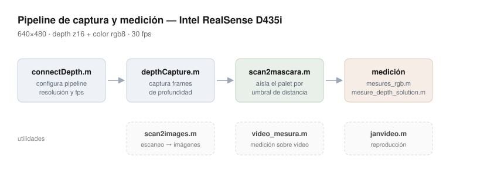
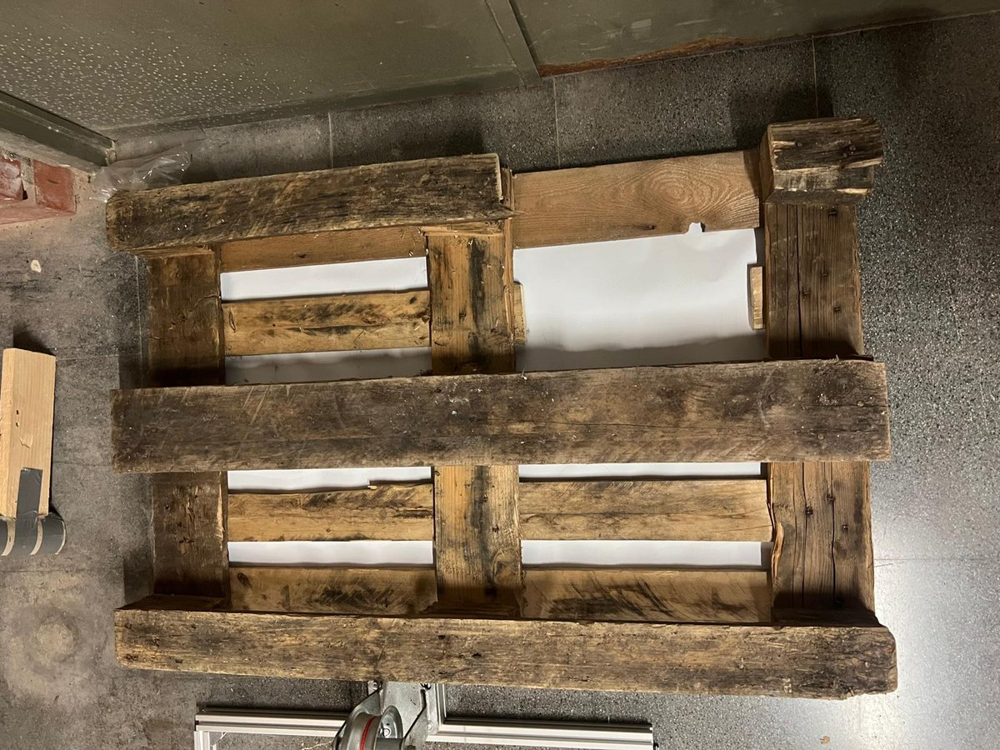
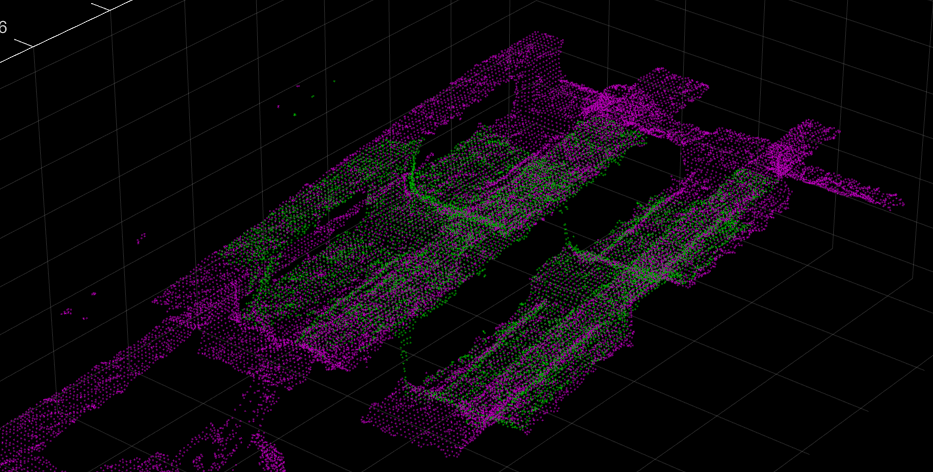
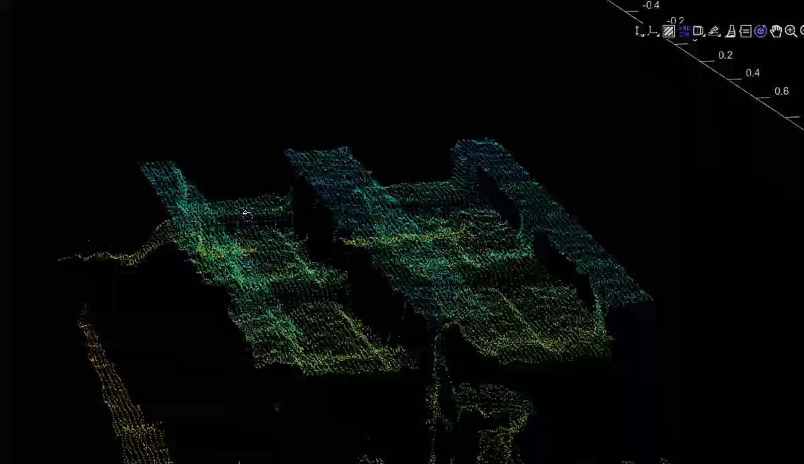
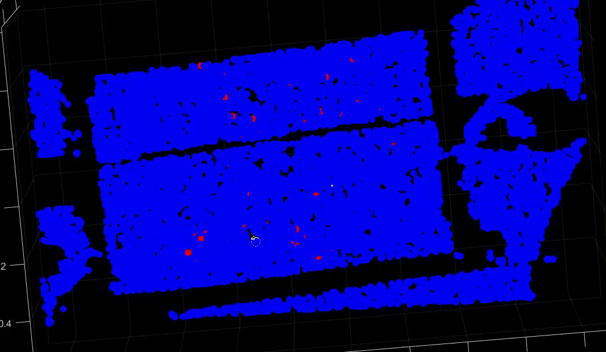

# PIE — Módulo de medición 3D con Intel RealSense D435i

Pipeline en MATLAB para capturar y medir palets mediante cámara de profundidad,
desarrollado como parte de la asignatura INT (ETSETB–UPC, curso 2024/25).

El objetivo del proyecto era detectar defectos en palets (medidas incorrectas,
tablas faltantes) dentro de un Product Inspection Entry automatizado, usando
cámaras 3D en lugar de inspección manual.

## Enfoque

El equipo evaluó **cuatro aproximaciones** en paralelo para no quedar atado a una
sola solución antes de invertir en una cámara cara: medición lateral, desde abajo,
con perspectiva, y mediante nube de puntos 3D.

Este repositorio corresponde al **cuarto enfoque: comprobación de integridad del
palet mediante mapa de puntos 3D**, usando una Intel RealSense D435i (una cámara
3D de gama baja, elegida por restricciones de presupuesto) para detectar grietas
y tablas faltantes.

## Mi aportación

Este repositorio contiene **únicamente la parte que desarrollé yo**: la captura
de profundidad y el pipeline de medición sobre nube de puntos. El proyecto
completo fue un trabajo de grupo y está disponible en
[mahelbdlm/INT](https://github.com/mahelbdlm/INT).

## Resultados

El palet físico utilizado en el prototipo, con tablas desgastadas y huecos
irregulares:

Reconstrucción en nube de puntos a partir del mapa de profundidad de la D435i.
Se distingue la estructura de tablas y los huecos entre ellas:

Vista en perspectiva de la misma captura, coloreada por altura:

Detección de defectos sobre la nube de puntos en vista cenital. Los puntos rojos
marcan las zonas donde la superficie se desvía de lo esperado — grietas y
tablas dañadas:

## Estructura

| Fichero | Qué hace |
|---|---|
| `connectDepth.m` | Configura el pipeline de la D435i (resolución y fps parametrizables) |
| `depthCapture.m` | Captura de frames de profundidad |
| `scan2images.m` | Conversión del escaneo a secuencia de imágenes |
| `scan2mascara.m` | Aísla el palet por umbral de distancia y genera la máscara |
| `mesures_rgb.m` | Medición sobre canal RGB, con detección de movimiento entre frames |
| `mesure_depth_solution.m` | Medición sobre mapa de profundidad vía Image Acquisition Toolbox |
| `video_mesura.m` | Medición sobre secuencias de vídeo |
| `janvideo.m` | Utilidad de reproducción de capturas |
| `prueba1.m` | Script de pruebas del pipeline |
| `indent.m` | Utilidad auxiliar |

## Requisitos

- MATLAB (probado con R2024a)
- Image Processing Toolbox / Computer Vision Toolbox
- Intel RealSense D435i + SDK

## Contexto

Desarrollado entre octubre y diciembre de 2024. El historial original de estos
commits está en el repositorio del grupo enlazado arriba.
