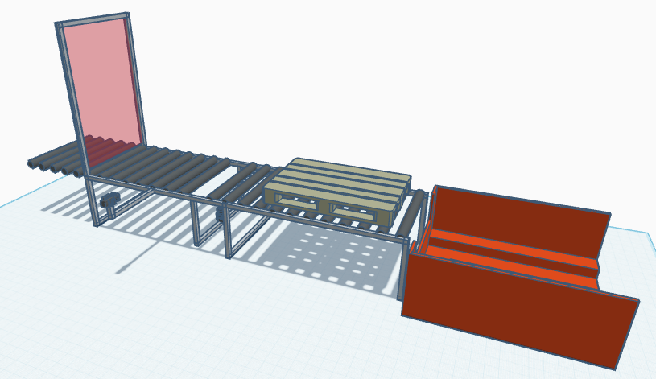
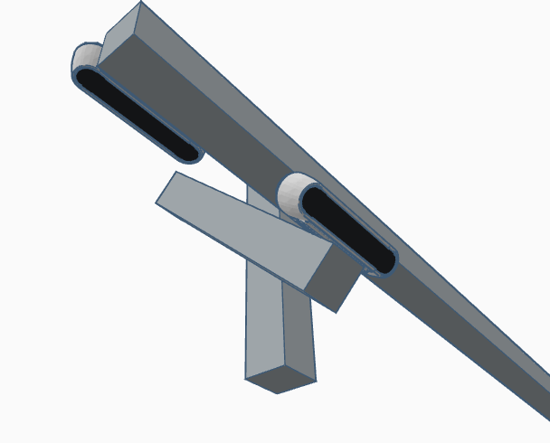
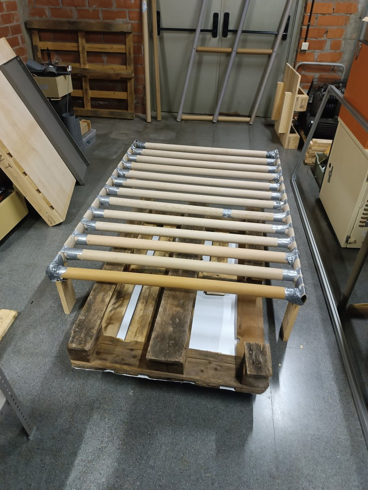

# PIE — Módulo de medición 3D con Intel RealSense D435i

Pipeline en MATLAB para capturar y medir palets mediante cámara de profundidad,
desarrollado como parte de la asignatura INT (ETSETB–UPC, curso 2024/25).

El objetivo del proyecto era detectar defectos en palets (medidas incorrectas,
tablas faltantes) dentro de un Product Inspection Entry automatizado, usando
cámaras 3D en lugar de inspección manual.


## El prototipo

Además del módulo de software, me encargué del **diseño y construcción del
prototipo físico**: el modelo CAD, el montaje, el posicionamiento y calibración
de las cámaras, y las máscaras de los transportadores.



No se podía tener un PIE a escala real en el laboratorio, así que el prototipo
invierte la geometría: el palet desliza **por debajo** de las máscaras y las
cámaras se montan **encima**, simulando la vista desde la parte inferior de los
transportadores de un PIE real. Una primera versión con el palet deslizando por
encima se descartó porque no se conseguía que corriese bien sobre las máscaras.

Dos cámaras, una perpendicular al transportador y otra a 45°, sobre un soporte
ajustable para poder variar ángulo y altura entre pruebas:



Las máscaras reproducen los dos tipos de transportador de un PIE —rodillos y
cadenas— para comprobar que el método aguanta en ambos casos. La de rodillos,
montada sobre el palet de pruebas:



Los criterios de diseño fueron que se pudiera desmontar con facilidad, que
fuera lo bastante rígido para que las medidas no bailaran, y que permitiera
ajustes a medida que el software pedía cambios. El firmware del motor paso a
paso que mueve la plataforma lo escribió otro miembro del equipo.

## Enfoque

El equipo evaluó **cuatro aproximaciones** en paralelo para no quedar atado a una
sola solución antes de invertir en una cámara cara: medición lateral, desde abajo,
con perspectiva, y mediante nube de puntos 3D.

Este repositorio corresponde al **cuarto enfoque: comprobación de integridad del
palet mediante mapa de puntos 3D**, usando una Intel RealSense D435i (una cámara
3D de gama baja, elegida por restricciones de presupuesto) para detectar grietas
y tablas faltantes.

## Mi aportación

Este repositorio contiene **únicamente la parte que desarrollé yo**: la captura
de profundidad y el pipeline de medición sobre nube de puntos. El proyecto
completo fue un trabajo de grupo y está disponible en
[mahelbdlm/INT](https://github.com/mahelbdlm/INT).

## Resultados

El palet físico utilizado en el prototipo, con tablas desgastadas y huecos
irregulares:


Reconstrucción en nube de puntos a partir del mapa de profundidad de la D435i.
Se distingue la estructura de tablas y los huecos entre ellas:


Vista en perspectiva de la misma captura, coloreada por altura:


Vista cenital de la nube de puntos durante una inspección:


## Cómo se detectan los defectos

El módulo no clasifica defectos directamente: mide el palet y lo compara contra
una referencia. Tres mecanismos encadenados.

### 1. Segmentación por umbral de profundidad

El mapa de profundidad llega en milímetros y se convierte a metros. El palet se
aísla del fondo y del suelo quedándose solo con los píxeles dentro de una banda
de distancia conocida:

```matlab
min_dist = 0.1;   % metros
max_dist = 0.75;
palet_mask = (depth >= min_dist) & (depth <= max_dist);
```

La banda depende de la altura a la que esté montada la cámara en el prototipo.
Todo lo que cae fuera (suelo, estructura, cinta) se descarta antes de medir.

### 2. Comparación por correlación de Pearson

Se capturan dos escaneos y se comparan píxel a píxel sobre la profundidad
segmentada, calculando el coeficiente de correlación de Pearson entre ambos
vectores y expresándolo en porcentaje.

La idea: un palet íntegro comparado con la referencia da una correlación alta.
Una tabla rota, un hueco o una grieta cambian la geometría local y hacen caer
ese porcentaje. Sirve como indicador de desviación, no como localizador del
defecto concreto.

### 3. Medición de dimensiones

Dos caminos independientes, para contrastar resultados:

**Vía profundidad** (`mesure_depth_solution.m`) — sobre un ROI seleccionado, el
tamaño de píxel se deriva del campo de visión de la D435i (87° × 58°) y la
resolución de captura:

```matlab
pixelSizeX = (2 * tan(deg2rad(87/2)) / 640) * 1000;   % mm/píxel
```

Con eso se obtienen ancho y alto en milímetros, más la profundidad media del
ROI. Las medidas se contrastan contra las normalizadas: 80 cm de ancho el palet
europeo, 100 cm el americano.

**Vía RGB** (`mesures_rgb.m`) — se restan dos frames consecutivos en escala de
grises y se umbraliza la diferencia para aislar lo que se ha movido:

```matlab
diff_image  = abs(double(gray1) - double(gray2));
motion_mask = diff_image > 30;
```

La máscara se limpia con apertura y cierre morfológicos (elemento estructurante
circular de radio 5), se detectan bordes con Canny, y de las regiones conectadas
se toma la de mayor área. Su bounding box da las dimensiones del palet.

## Conclusiones

Lo que el enfoque demostró:

- El umbral de profundidad aísla el palet del fondo y de la estructura del
  prototipo de forma fiable, siempre que la cámara esté a una altura conocida.
- La D435i, pese a ser una cámara 3D de gama baja elegida por presupuesto, da
  una nube de puntos con resolución suficiente para que la estructura de tablas
  y los huecos entre ellas sean distinguibles a simple vista.
- Las grietas y tablas faltantes aparecen como discontinuidades claras en la
  nube de puntos.
- La correlación de Pearson entre escaneos funciona como indicador de
  desviación respecto a una referencia.

Ninguna de estas conclusiones se sostiene por sí sola: las medidas obtenidas por
esta vía se contrastaron con las de los otros tres enfoques del equipo —medición
lateral, desde abajo y con perspectiva— sobre los mismos palets. Comparar los
resultados entre métodos fue lo que permitió juzgar cuál era fiable y cuál
merecía la inversión en una cámara de gama alta. Los datos de los otros enfoques
están en el [repositorio del grupo](https://github.com/mahelbdlm/INT).

Lo que quedó abierto:

- Localización y clasificación automática del defecto, hoy a cargo del operador.
- Calibración independiente de la altura de montaje.
- Lectura directa desde la cámara en lugar de ficheros `.mat` pregrabados.

Este fue uno de los cuatro enfoques evaluados en paralelo por el equipo, y la
decisión final salió de cruzar los resultados de todos ellos, no de ninguno por
separado.

## Limitaciones conocidas

- La correlación devuelve un único escalar para toda la imagen: indica cuánto
  se desvía el palet respecto a la referencia, pero no da coordenadas. La
  localización del daño se hace inspeccionando la nube de puntos o el mapa
  de profundidad segmentado, donde las grietas y tablas faltantes se ven con
  claridad. Automatizar ese paso quedó fuera del alcance del proyecto.
- La conversión de píxeles a metros en la vía RGB usa un factor fijo calibrado
  para una distancia concreta; cambiar la altura de la cámara lo invalida.
- El cálculo de tamaño de píxel vía FOV asume un plano a profundidad constante.
- `mesure_depth_solution.m` requiere seleccionar el ROI a mano.
- Los scripts parten de capturas `.mat`; una versión de producción leería los
  frames directamente de la cámara.

## Estructura

| Fichero | Qué hace |
|---|---|
| `connectDepth.m` | Configura el pipeline de la D435i (resolución y fps parametrizables) |
| `depthCapture.m` | Captura de frames de profundidad |
| `scan2images.m` | Conversión del escaneo a secuencia de imágenes |
| `scan2mascara.m` | Aísla el palet por umbral de distancia y genera la máscara |
| `mesures_rgb.m` | Medición sobre canal RGB, con detección de movimiento entre frames |
| `mesure_depth_solution.m` | Medición sobre mapa de profundidad vía Image Acquisition Toolbox |
| `video_mesura.m` | Medición sobre secuencias de vídeo |
| `janvideo.m` | Utilidad de reproducción de capturas |
| `prueba1.m` | Script de pruebas del pipeline |
| `indent.m` | Utilidad auxiliar |

## Requisitos

- MATLAB (probado con R2024a)
- Image Processing Toolbox / Computer Vision Toolbox
- Intel RealSense D435i + SDK

## Contexto

Desarrollado entre octubre y diciembre de 2024. El historial original de estos
commits está en el repositorio del grupo enlazado arriba.
